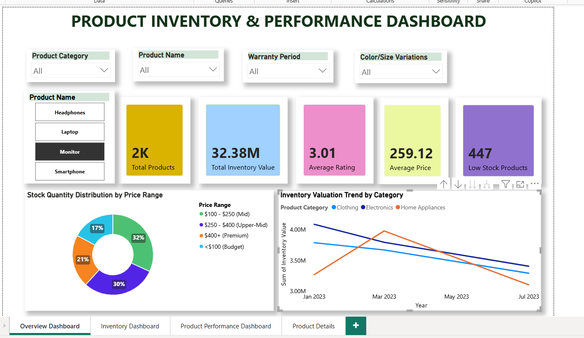
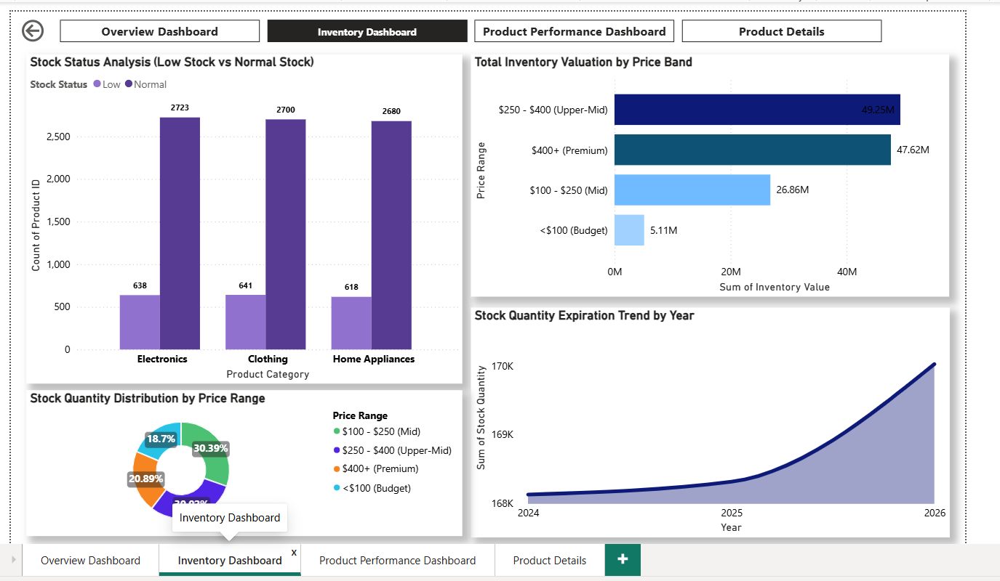
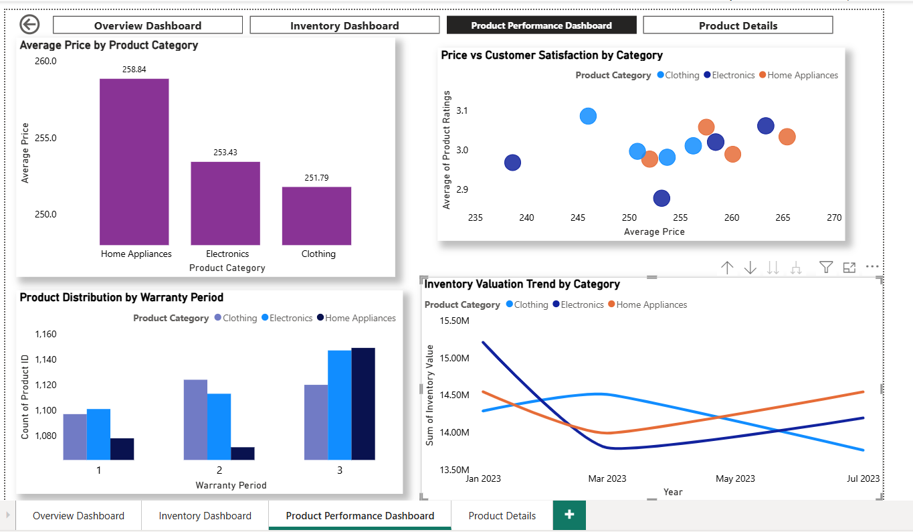
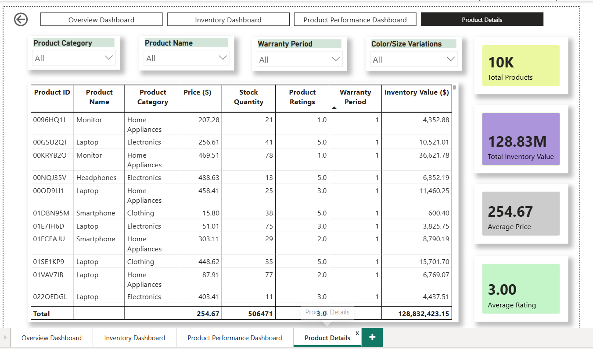

# Product Inventory & Performance Dashboard

## Project Overview

This Power BI project analyzes product inventory and performance data to support better inventory management and business decision-making.

The dashboard focuses on stock levels, inventory value, product pricing, customer ratings, warranty periods, and product-level analysis.

## Dashboard Pages

1. Overview Dashboard
2. Inventory Dashboard
3. Product Performance Dashboard
4. Product Details

## Key KPIs

- Total Products
- Total Inventory Value
- Average Price
- Average Rating
- Low Stock Products

## Key Features

- Interactive slicers
- Inventory value analysis
- Low-stock monitoring
- Product price and rating analysis
- Warranty analysis
- Drill-through product details

## Tools Used

- Microsoft Power BI
- Power Query
- DAX

## Dashboard Preview

## Author

Vijini Wijerathna